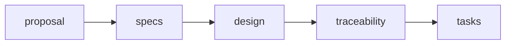

# Buoy examples

These examples show requirement checks, stale links, change checks, and trace reports.

## Before you start

Install `buoy` with the digest features shown in the [root README](../README.md#install-from-source).
Run these commands from the repository root.
You do not need Nix or the OpenSpec CLI for these checks.

## Check OpenSpec requirements

```sh
buoy static \
  --root examples/repositories/openspec-authority \
  --config examples/repositories/openspec-authority/buoy.toml \
  --format machine
```

The command returns exit code `0`.
Its JSON report matches [openspec-static.json](expected/openspec-static.json).
Requirement `DEMO-001` has no executable coverage in this example.

The configuration defines the requirement scope, lifecycle, reserved IDs, and approval rules.
The [external link example](repositories/openspec-authority/docs/all-relations.md) contains the four supported navigation relations.
Those links do not count as test coverage.

## Detect a stale link

```sh
buoy static \
  --root examples/repositories/stale-external-link \
  --config examples/repositories/stale-external-link/buoy.toml \
  --format machine
```

The command returns exit code `2` with `SPG-REF-DANGLING-OR-STALE`.
The saved external link no longer names the current requirement revision.

## Check a change

The [change example](repositories/change-check/) contains separate base and head directories.
The requirement text changes between them.
Each change manifest names the exact base and head revisions.

The complete manifest records a decision for the changed requirement:

```sh
buoy change \
  --base examples/repositories/change-check/base \
  --head examples/repositories/change-check/head \
  --config examples/repositories/change-check/buoy.toml \
  --manifest examples/repositories/change-check/complete.toml \
  --format machine
```

The command returns exit code `0`.
Its report matches [change-complete.json](expected/change-complete.json).

The incomplete manifest omits that decision:

```sh
buoy change \
  --base examples/repositories/change-check/base \
  --head examples/repositories/change-check/head \
  --config examples/repositories/change-check/buoy.toml \
  --manifest examples/repositories/change-check/incomplete.toml \
  --format machine
```

The command returns exit code `3` with `CHG-DISPOSITION-MISSING`.

## Create a trace page

```sh
buoy trace \
  --root fixtures/readable-trace-projections/v1/repository \
  --config fixtures/readable-trace-projections/v1/repository/buoy.toml \
  --relation-id BGLC-RENDER-CATALOG \
  --format markdown
```

The command prints the [saved trace page](expected/trace-page.md) to standard output.
It does not edit a repository file.
The page connects requirement `BGLC-003` to `src/lib.rs::render_catalog`.
It reports the link state and the freshness of each saved reference.

A saved page can become stale.
Run the query again to inspect current files.

## Rust API examples

- [core_graph.rs](core_graph.rs) builds a typed graph and checks current or stale relations.
- [repository_check.rs](repository_check.rs) parses configuration and checks a repository through the Rust API.

These source examples use the same core values and repository checks as the CLI.

## Optional OpenSpec workflow

Copy [openspec-workflow/](openspec-workflow/) into a separate project to use the `buoy-traceability` schema.
The OpenSpec CLI validates that workflow.
Buoy itself reads the saved standing specifications, not active change documents.

The workflow uses this artifact order:



Templates guide authors. They do not grant approval or establish test coverage.
The [completed traceability example](openspec-workflow/completed-traceability.md) shows a saved report for one fixture.
Use a new Buoy query for current state.

## Development checks

Repository checks cover the Rust examples, saved reports, repository inputs, and workflow templates.
See the [development guide](../docs/engineering/enforcement-order.md) for those commands.

## Limits

Static checks and trace queries do not run tests or read live provider data.
A current link does not prove that the code meets its requirement.
Test and proof records apply only to their declared inputs and scope.
